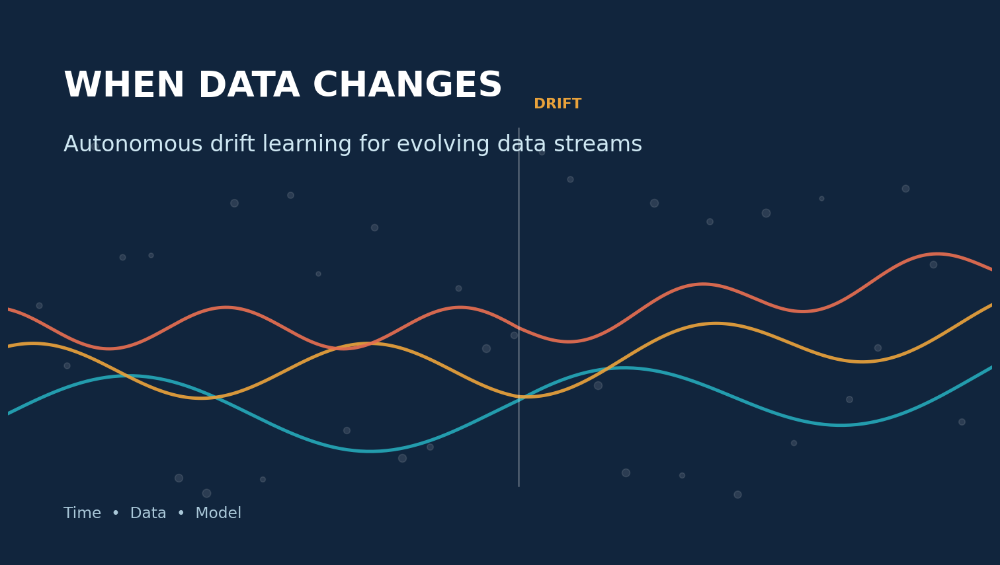
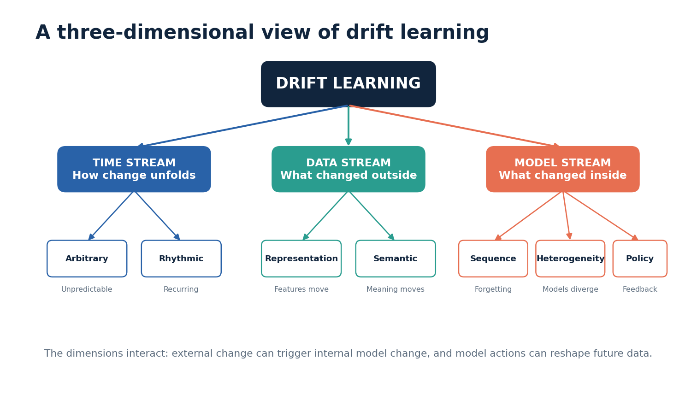
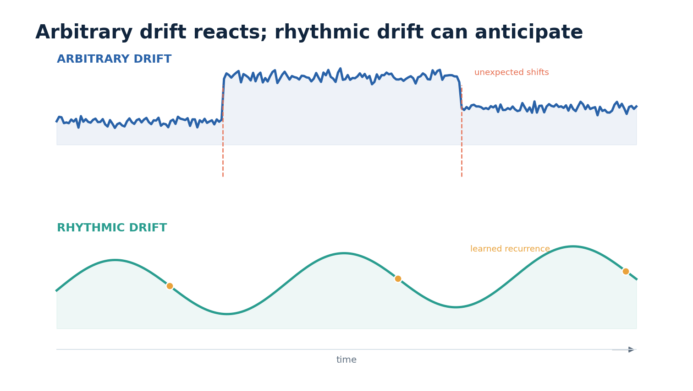
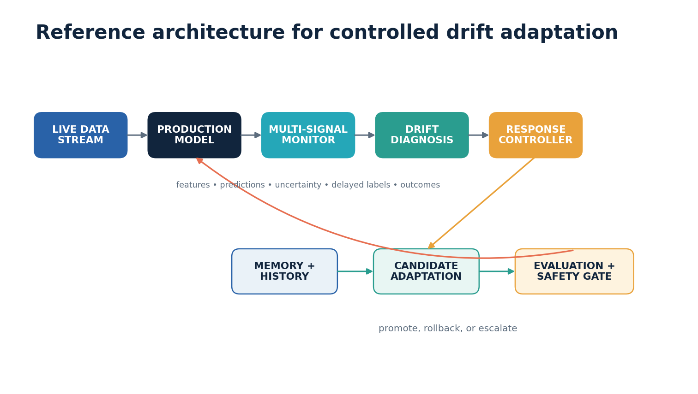
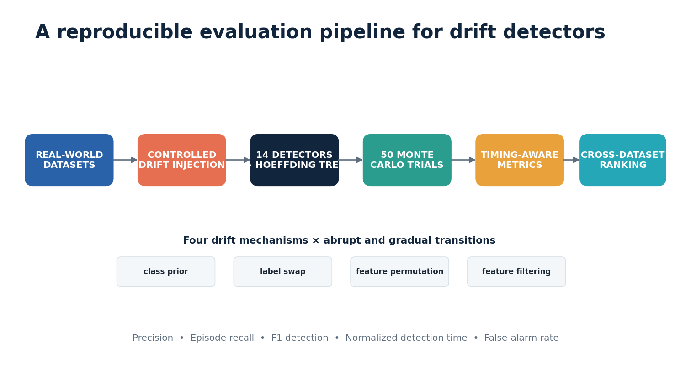
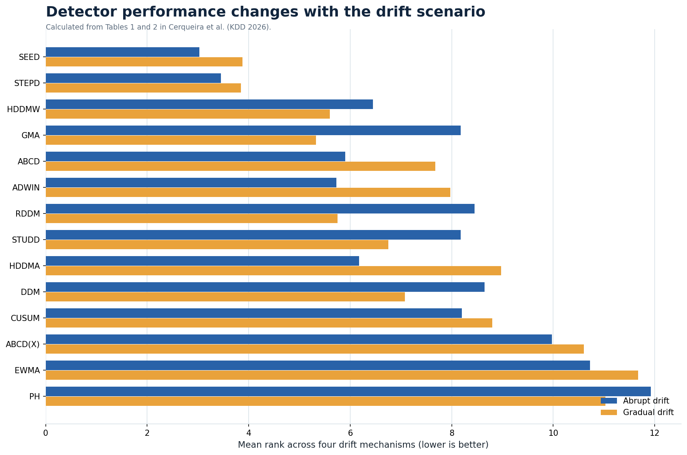

# When Data Changes: How Autonomous Systems Learn from Concept Drift

*A practical look at drift detection, adaptation, evaluation, and the road from static models to continuously learning systems*

By Praneeth Kalangi

Most machine-learning projects end with a reassuring number: 92% accuracy, an F1 score of 0.88, or an error rate below the previous baseline. Those numbers describe a particular test set at a particular moment. Production data does not promise to remain in that moment.

Consider a bank that trains a fraud detector in January. By summer, customers have adopted new payment apps, merchants have changed their checkout flows, and fraudsters have learned which transactions the system flags. The code may be unchanged, the servers may be healthy, and the monitoring dashboard may still be green. Yet the relationship between transaction features and fraud has moved. Yesterday's model now judges today's behavior using yesterday's world.

Researchers call this problem **concept drift**. A recent survey, [*Autonomous Drift Learning in Data Streams: A Unified Perspective*](https://arxiv.org/abs/2605.01295), argues that the familiar concept-drift framing is no longer broad enough. The authors review 193 studies and organize change across three connected dimensions: time, incoming data, and the model itself. Their larger idea is **drift learning**: a system should not merely notice that something changed. It should understand the form of the change, adapt without destroying useful knowledge, and eventually anticipate recurring change.

That is an ambitious goal. It also changes how we should design and evaluate long-running machine-learning systems.

## A model is a snapshot of a moving process

Traditional supervised learning assumes that training and future observations come from approximately the same distribution. If the joint distribution at time *t* is written as P_t(X,Y), drift occurs when that distribution differs at a later time:

> P_t(X,Y) is not equal to P_(t+Δt)(X,Y)

The notation is less important than the operational meaning. Something about the inputs, labels, or relationship between them has changed.

Two changes that look similar in a dashboard can have very different consequences. If the devices used to take photographs improve, the pixel distribution may change while the meaning of each label remains stable. This is often called virtual or covariate drift. If the meaning connecting an input to its correct label changes, the model's decision boundary may become obsolete. That is real concept drift.

Earlier research usually organized a drift-handling system around detection, understanding, and adaptation. The influential 2019 review [*Learning under Concept Drift*](https://doi.org/10.1109/TKDE.2018.2876857) synthesized more than 130 publications around that pipeline. The 2026 survey expands the scope. It treats the operating state as a combination of the external distribution and the model's internal state. A system can therefore drift because its environment changes, because its own parameters diverge, or because both evolve together.

*Figure 1. An original summary of the taxonomy proposed by Yang, Yu, and Lu (2026).*

## The first dimension: how change unfolds over time

The survey divides **time-stream drift** into arbitrary and rhythmic change.

### Arbitrary drift demands a reaction

Arbitrary drift is unpredictable. A fraud pattern can change after criminals discover a new weakness. A sensor can degrade without warning. A new regulation can immediately alter customer behavior. The system cannot schedule these events in advance, so it needs a continuous loop:

1. Make a prediction.
2. Observe an error signal or distribution statistic.
3. Test whether the change is meaningful.
4. Adapt the model if the evidence is strong enough.

Classical detectors implement this loop in different ways. DDM and EDDM monitor predictive errors. Page-Hinkley and CUSUM accumulate evidence of a shift. ADWIN maintains an adaptive window and shrinks it when two parts of the window appear to come from different distributions. Modern detectors also monitor learned representations, uncertainty, or auxiliary losses when labels arrive slowly.

The hard part is not simply reacting quickly. An aggressive detector may treat random noise as drift and trigger unnecessary retraining. A conservative detector may protect stability but recognize a harmful shift too late. Every real system must negotiate this false-alarm-versus-delay tradeoff.

### Rhythmic drift creates an opportunity to anticipate

Rhythmic drift follows a recurring or smoothly evolving structure. Electricity demand changes by time of day. Retail behavior moves through weekly and seasonal cycles. Traffic patterns differ between weekdays and weekends. These are not stationary processes, but they are not entirely surprising either.

When a system recognizes periodicity or a stable trend, it can prepare for the next regime instead of waiting for accuracy to collapse. The model might retain specialized components for different seasons, predict future feature statistics, or learn a trajectory through a sequence of domains.

*Figure 2. Arbitrary drift produces irregular changes, while rhythmic drift exposes structure that a system may learn to anticipate.*

This distinction is one of the survey's most useful ideas. Many monitoring systems assume every change is an incident. In practice, some changes are recurring operating conditions. Treating both cases identically wastes information.

## The second dimension: what changed in the data

The survey separates **representation drift** from **semantic drift**.

Representation drift changes how observations appear. A manufacturer may replace a camera, a mobile operating system may modify sensor calibration, or a network upgrade may alter packet-level features. The input space moves even if the task itself remains recognizable.

Semantic drift changes the meaning that connects inputs and outputs. A phrase that once indicated a negative customer review may become playful slang. A financial transaction pattern that was once harmless may become associated with fraud. A medical risk threshold may change after new clinical evidence.

The distinction matters because the repair is different. Representation drift may be handled through feature alignment, normalization, reconstruction, or domain-invariant embeddings. Semantic drift may require new labels, decision-boundary updates, uncertainty estimation, or continual learning. A feature-space detector can recognize that inputs moved, but it cannot reliably detect a label-only change that leaves P(X) nearly untouched.

The 2026 survey groups semantic-drift approaches into several families. Invariant representation learning tries to preserve stable causal or geometric structure. Test-time and continual adaptation update the model as new evidence arrives. Probabilistic methods quantify uncertainty and attempt to reconstruct degraded semantics. Distributed systems also need semantic synchronization so that different clients do not quietly develop incompatible meanings.

## The third dimension: the learner can drift too

The most interesting extension is **model-stream drift**. Even with stable incoming data, the learner's internal state may evolve in undesirable ways.

**Sequence drift** appears during continual learning. Repeated updates improve performance on recent data but can erase older knowledge, a failure known as catastrophic forgetting. Regularization, memory replay, adapters, and dynamic architectures all attempt to balance stability with plasticity.

**Heterogeneity drift** occurs when multiple learners diverge. In federated learning, hospitals, phones, or factories train local models on different data at different speeds. Their parameters and representations can gradually move apart, making aggregation less reliable.

**Policy drift** appears in decision-making systems. A recommender, pricing system, or reinforcement-learning agent changes the environment through its own actions. Those actions influence the next observations, which then influence the next model update. Without constraints, this feedback loop can amplify unstable behavior.

My main takeaway is that production monitoring should not stop at input distributions and prediction accuracy. It should also track representation movement, parameter change, update magnitude, disagreement between models, and the behavior induced by model decisions.

## What an autonomous drift-learning architecture needs

A useful architecture separates observation, diagnosis, adaptation, and validation.

*Figure 3. A reference architecture for continuous drift monitoring and controlled adaptation.*

The live model first produces predictions from an incoming stream. A monitoring layer records feature statistics, output distributions, uncertainty, delayed labels, and business outcomes. The detector converts these signals into evidence of change.

Detection should not immediately replace the model. A diagnosis stage estimates the likely drift family and its severity. A response controller then chooses among several actions:

- Continue monitoring when evidence is weak.
- Adjust a threshold or calibration layer for a small change.
- Reweight an ensemble when one component becomes unreliable.
- Update selected parameters or adapters.
- Retrain using a recent window.
- Restore an earlier specialist for a recurring regime.
- Escalate to a human reviewer when the risk is high.

The candidate update must pass an evaluation gate. That gate should measure recent predictive quality, historical retention, detection cost, fairness, latency, and domain-specific safety constraints. Only then should the system promote the candidate to production.

This controlled loop is important. Fully automatic retraining sounds attractive, but a false alarm can turn a temporary disturbance into a permanent model change.

## Evaluating a detector is harder than evaluating a classifier

A classifier is often judged using predictions and labels. A drift detector produces alarms along a timeline, and the exact start of a real drift is usually unknown. That makes ground truth difficult.

The KDD 2026 paper [*A Framework for Evaluating and Benchmarking Concept Drift Detection Methods*](https://arxiv.org/abs/2606.07789) addresses this evaluation problem. The authors inject controlled changes into seven real-world datasets, preserving realistic feature distributions while creating known drift points. They evaluate 14 detectors across four change mechanisms, using abrupt and gradual transitions. Each dataset-and-drift combination is repeated over 50 Monte Carlo trials.

*Figure 4. The KDD 2026 framework creates known drift points in real data and evaluates both detection quality and timing.*

The four simulated changes represent different failure modes:

| Drift mechanism | What changes |
|---|---|
| Class-prior drift | The frequency of a class changes |
| Label-swap drift | The relationship between examples and labels changes |
| Feature permutation | The arrangement of feature information changes |
| Feature filtering | Part of the feature distribution is removed |

The framework also uses leave-one-dataset-out optimization. Parameters are tuned on six datasets and evaluated on the held-out seventh dataset. This matters because tuning and testing on the same stream can make a detector appear more general than it is.

### Metrics need to capture accuracy and timing

Precision answers whether alarms correspond to real drift. Recall answers whether real drift episodes were detected. Their harmonic mean gives an F1 detection score. These are useful but incomplete.

A detector that raises a correct alarm after the damage is done can still receive credit. The benchmark therefore reports normalized detection time, which measures the delay relative to the acceptable detection window. It also tracks episode recall and false-alarm rate. The authors recommend interpreting timing alongside detection coverage because normalized delay excludes completely missed events.

The practical lesson is simple: there is no honest single-number leaderboard for drift detection. A deployment team should examine at least four questions:

1. How many meaningful changes did the detector catch?
2. How many false alarms did it generate?
3. How long did detection take?
4. What computational and retraining cost followed each alarm?

## What the benchmark reveals

The benchmark reports average detector ranks rather than claiming that one method wins everywhere. Lower rank means better relative performance.

*Figure 5. Mean rank across the four tested drift mechanisms. Values are calculated from Tables 1 and 2 of Cerqueira et al. (2026); lower is better.*

SEED and STEPD rank consistently well across many scenarios. Gradual drift is generally harder than abrupt drift. Several detectors also show strong specialization. ABCD(X), which monitors feature space without labels, performs extremely well on abrupt feature permutation but poorly on label-based change. This is expected: a detector cannot observe a change that exists only in Y when it monitors only X.

The result I find most important is not the identity of the top detector. It is the absence of a universal winner. Monitoring error rates, features, predictions, and representation statistics exposes different kinds of change. A production architecture should choose signals based on label availability and failure risk, and it may need multiple complementary detectors.

The benchmark also reports that tuned configurations outperform defaults. This serves as a useful ablation: removing cross-dataset optimization reduces detection quality and can change method rankings. “Default settings” are not a neutral scientific baseline when defaults were developed around particular data characteristics.

## Where drift learning matters

### Fraud and cybersecurity

Attackers deliberately adapt. A detector that learns one attack pattern may push adversaries toward another. Here, label delays and class imbalance make monitoring difficult. Feature drift can reveal new traffic patterns, while semantic drift can change what a suspicious pattern means.

### Healthcare

Clinical populations, measurement devices, treatment practices, and coding rules change. Blind adaptation is risky because a shift can reflect either genuine medical change or a data-quality failure. A safe system needs provenance, human review, and evidence that adaptation improves outcomes across patient groups.

### Recommendations

User preferences change, but recommendations also shape future behavior. The system participates in the distribution it observes. This is a policy-drift problem as much as a data-drift problem, and it requires monitoring exposure, diversity, and feedback loops in addition to click accuracy.

### Autonomous vehicles and robotics

Weather, lighting, surfaces, and human behavior create open-world change. A vehicle needs fast adaptation, but unsafe updates are unacceptable. Constrained policies, uncertainty estimation, simulation, and rollback mechanisms become part of the drift-learning architecture.

## What the survey gets right, and what remains unresolved

The three-dimensional taxonomy is valuable because it prevents teams from reducing every production problem to “the input distribution changed.” It links concept-drift research with continual learning, federated learning, temporal generalization, and reinforcement learning.

At the same time, the framework is primarily a synthesis, not a validated end-to-end system. It tells us what a complete drift learner should reason about, but it does not prove that one architecture can reliably distinguish all seven subcategories in real time.

Three open problems stand out to me.

First, **correlation is not diagnosis**. A detector may show that accuracy fell at the same time feature statistics moved. It does not automatically establish why the change occurred. Causal drift analysis could help distinguish a new customer population from a sensor fault or policy change.

Second, **adaptation creates its own risk**. Every update can introduce forgetting, bias, instability, or a new security surface. The safest action may sometimes be to collect labels or route cases to people rather than update immediately.

Third, **beneficial change and harmful change look similar at first**. A model may discover a better representation, or it may collapse. A distributed client may specialize productively, or it may become incompatible with the global system. Future monitors must judge direction and consequence, not merely movement.

## From model maintenance to learning through change

Static evaluation answers whether a model worked on yesterday's held-out data. Drift learning asks whether the entire learning system can remain reliable as the environment, semantics, and model state evolve.

The 2026 survey supplies a vocabulary for this broader problem. The KDD benchmark supplies a more disciplined way to test one critical part of it. Together, they suggest a practical direction: monitor multiple signals, diagnose before adapting, evaluate timing and false alarms, preserve memory, and place safety gates around automatic updates.

The goal is not a model that changes whenever the data moves. It is a system that knows what kind of change it is seeing, chooses a proportional response, and can explain why that response is safer than doing nothing.

That is the difference between a model that merely survives change and a learning system designed to learn through it.

## References

1. Yang, X., Yu, E., & Lu, J. (2026). [Autonomous Drift Learning in Data Streams: A Unified Perspective](https://arxiv.org/abs/2605.01295). arXiv:2605.01295.
2. Cerqueira, V., Gomes, H. M., Heyden, M., Pfahringer, B., & Bifet, A. (2026). [A Framework for Evaluating and Benchmarking Concept Drift Detection Methods](https://arxiv.org/abs/2606.07789). Proceedings of KDD 2026. https://doi.org/10.1145/3770855.3819070
3. Lu, J., Liu, A., Dong, F., Gu, F., Gama, J., & Zhang, G. (2019). [Learning under Concept Drift: A Review](https://doi.org/10.1109/TKDE.2018.2876857). IEEE Transactions on Knowledge and Data Engineering, 31(12), 2346–2363.
4. Bifet, A., & Gavaldà, R. (2007). [Learning from Time-Changing Data with Adaptive Windowing](https://doi.org/10.1137/1.9781611972771.42). Proceedings of the SIAM International Conference on Data Mining.
5. Gomes, H. M., et al. (2017). [Adaptive Random Forests for Evolving Data Stream Classification](https://doi.org/10.1007/s10994-017-5642-8). Machine Learning, 106, 1469–1495.

